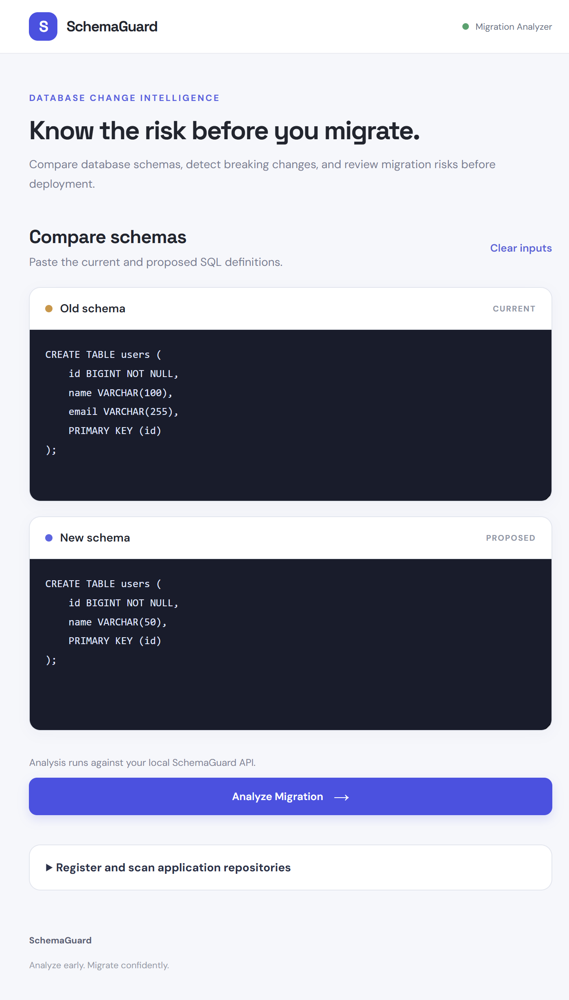

# SchemaGuard

### A Hierarchical Database Migration Risk and Application Impact Analyzer

SchemaGuard analyzes a proposed database migration alongside application source code to identify which applications, APIs, and repository components may depend on the changing schema. It analyzes schema metadata and code; it does not manage, connect to, or store a company's application data.

The project combines a Java + Spring Boot backend with a React + Vite frontend. It parses schema definitions, compares old and new database structures, classifies migration risk, scans multiple registered application repositories for dependency evidence, and reports potentially affected components with evidence, confidence, scan coverage, and recommendations.

This project is intentionally conservative: unsupported SQL is rejected clearly instead of being silently interpreted, and dependency analysis is evidence-backed but not claimed to be perfect.

## Why SchemaGuard exists

Database schema changes are often deceptively simple. A column rename, type change, new constraint, or dropped table can be harmless in one context and breaking in another. SchemaGuard provides a structured, reviewable answer for:

- what changed between two schema versions
- whether the change is low, medium, or high risk
- which applications may depend on the affected tables or columns
- which migration steps must be validated before production rollout
- where the evidence for dependency impact came from

## Project architecture

The system is structured as layered services, each responsible for a narrow part of the workflow:

- Parser layer: converts SQL scripts into a structured schema model
- Diff engine: compares old and new schemas and emits schema changes
- Risk rules in the diff engine: assign a risk level and rationale to each change
- Dependency registry: stores manually known application-to-table relationships
- Repository scanner: looks for static SQL references in supported source files
- Impact analysis: matches a schema change to dependencies by database, table, and column
- Risk-score calculator: combines change severity, affected application count, and evidence confidence
- API layer: exposes comparison and impact-aware endpoints
- Frontend: visualizes schema differences, warnings, impacts, and migration plans

## High-level flow

```text
+---------------------------+
| User or API client        |
| submits old/new schema    |
+-------------+-------------+
              |
              v
+---------------------------+
| MySqlSchemaParser         |
| Parses CREATE/ALTER SQL   |
| into DatabaseSchema       |
+-------------+-------------+
              |
              v
+---------------------------+
| SchemaDiffEngine          |
| Compares schemas          |
| Finds ADDED/MODIFIED/REMOVED objects |
+-------------+-------------+
              |
              v
+---------------------------+
| SchemaRiskClassifier      |
| Assigns risk levels and  |
| recommendation rules     |
+-------------+-------------+
              |
              v
+---------------------------+
| Dependency registry +     |
| static repository scan    |
| matched by DB/table/column|
+-------------+-------------+
              |
              v
+---------------------------+
| ApplicationImpactAnalysisService |
| Maps impacted apps to schema changes |
+-------------+-------------+
              |
              v
+---------------------------+
| API response / frontend  |
| risk summary / impact /  |
| migration plan           |
+---------------------------+
```

## Detailed design

### 1. Backend

The backend lives under [backend](backend). It is a Spring Boot application using Java 21 and Maven.

Key backend packages:

- [backend/src/main/java/com/schemaguard/controller](backend/src/main/java/com/schemaguard/controller)
  - REST controllers for schema parsing, diffing, impact analysis, registry operations, and scanning
- [backend/src/main/java/com/schemaguard/parser](backend/src/main/java/com/schemaguard/parser)
  - SQL parsing and supported DDL handling
- [backend/src/main/java/com/schemaguard/diff](backend/src/main/java/com/schemaguard/diff)
  - schema comparison, schema change generation, risk classification
- [backend/src/main/java/com/schemaguard/model](backend/src/main/java/com/schemaguard/model)
  - schema model, diff request/response DTOs, dependency evidence, impact and score models
- [backend/src/main/java/com/schemaguard/service](backend/src/main/java/com/schemaguard/service)
  - persisted dependency registry, bounded scanning, impact matching, risk-score calculation

### 2. Frontend

The frontend is under [frontend](frontend) and is built with React + Vite.

It provides:

- SQL editor inputs for old and new schema
- schema comparison request execution
- risk summary display
- filtering and sorting of changes by risk level
- dependency impact panels
- migration plan recommendations
- explicit error display when dependency-aware analysis fails

### 3. Supported SQL safety model

SchemaGuard is intentionally explicit about the boundaries of support.

It supports the SQL patterns it can safely model and rejects unsupported statements loudly instead of pretending to understand them. This is important because false confidence is worse than a clear error in migration review.

Examples of supported patterns include:

- CREATE TABLE
- ALTER TABLE ADD COLUMN
- ALTER TABLE DROP COLUMN
- ALTER TABLE MODIFY COLUMN
- column and table rename flows where representable
- index and constraint handling in supported cases
- drop-table flows

Unsupported statements are rejected with an IllegalArgumentException or HTTP 400-style validation error.

## Core workflow

### Parse step

The parser reads a SQL script and produces a final `DatabaseSchema` object containing:

- tables
- columns
- primary keys
- indexes
- constraints

The parser preserves statement order for supported migration operations, so the final schema reflects the actual sequence of valid DDL changes.

### Diff step

The diff engine compares two schema models and emits a list of `SchemaChange` objects. Each object contains:

- object type (TABLE, COLUMN, INDEX, CONSTRAINT, PRIMARY_KEY)
- operation type (ADDED, REMOVED, MODIFIED)
- table name and object name
- old/new values
- risk level
- human-readable change description

### Risk classification

Risk classification is centralized in the risk classifier so that changes are scored consistently and recommendations remain aligned with actual diff results.

Risk examples include:

- dropping a column or table -> high risk
- changing the primary key -> high risk
- adding or removing foreign key constraints -> high risk / medium depending on style
- changing nullability to NOT NULL -> high risk
- widening integer types -> low risk
- index removal -> medium risk
- index addition -> low risk

### Recommendation generation

Recommendation text is conditional and practical. It does not assume every change is safe or unsafe without evidence. Recommendations are based on:

- destructive data operations
- nullability enforcement
- type conversion risk
- primary key / foreign key changes
- index build or lock implications

### Dependency discovery

SchemaGuard discovers dependencies in two ways:

1. Manual registration
   - register an application and its database
   - register table-level or column-level READ/WRITE dependencies
2. Static repository scanning
   - scan multiple local repositories or download public GitHub repository archives for supported static SQL and ORM table references
   - associate Python Flask SQL references with recognizable route methods, paths, and handler names
   - record relative source paths, query evidence, and detector confidence
3. Impact matching
   - match changed table/column names against registrations for the requested database
   - show potential matches with evidence and confidence
   - explicitly distinguish applications with no match in analyzed files from applications that have not been scanned

This design keeps discovery conservative and explainable rather than pretending to infer every runtime relation.

## API surface

The project exposes several API routes.

### Schema APIs

- POST /api/v1/schema/parse
  - Parse an SQL script into a `DatabaseSchema`
- POST /api/v1/schema/diff
  - Compare old and new SQL and return risk summary and schema changes
- POST /api/v1/schema/diff-with-impact
  - Requires `databaseName`; returns diff results, matching application evidence, a numeric risk-score breakdown, and migration plan

### Dependency APIs

- POST /api/v1/dependencies/applications
  - Register or update an application and the database it uses
- GET /api/v1/dependencies/applications
  - List registered applications
- POST /api/v1/dependencies/entries
  - Register known dependencies
- GET /api/v1/dependencies/entries
  - List dependency entries
- POST /api/v1/dependencies/scan
  - Scan a local folder or a public GitHub repository URL for likely SQL references, recording source evidence and recognizable Flask routes against an application

### End-to-end dependency test

Start the backend and frontend, open the UI, and expand **Register and scan application repositories**. Choose the database being analyzed, enter an application ID, display name, and either a local repository folder path or a public GitHub repository root URL for each application, then select **Register and scan all repositories**. The scan result lists the actual referenced table names and detected APIs/source components, including the tables they use and the matching SQL evidence. Use **Add another application repository** to include more applications. Private GitHub repositories and links to subfolders are not supported. For a Flask repository, discovered SQL references are associated with route methods, paths, and handler names when the query is inside a decorated route function. Analyze the schema change to see affected applications and their API/source evidence under **Potentially affected applications**.

Applications with a matching dependency are labeled **Potentially affected**. A completed scan without a matching reference is labeled **No matching reference found** and reports the number of analyzed files; this is not proof that the app is unaffected. Apps that have not completed a scan are labeled **Not scanned**, meaning their impact is unknown. If the scan hit its file limit, the report says coverage is incomplete.

For manual registration instead, fill in the application, database, table, and (optionally) a column, then select **Save dependency**. For example:

- Application ID: `orders-api`
- Application name: `Orders API`
- Database: `commerce`
- Table: `customers`
- Column: `email`
- Usage: `Reads`

Then analyze these schemas:

```sql
-- Old schema
CREATE TABLE customers (
    id BIGINT NOT NULL,
    email VARCHAR(255),
    PRIMARY KEY (id)
);
```

```sql
-- Proposed schema
CREATE TABLE customers (
    id BIGINT NOT NULL,
    PRIMARY KEY (id)
);
```

The impact report should show `Orders API`, the `customers.email` dependency, its source/evidence and confidence, and a numeric risk score. Register a second application against a different table and verify it is not listed for this change. A table-level dependency (leave the column blank) should match any changed column on that table.

The same workflow can be exercised through the API:

```powershell
$base = "http://localhost:8080/api/v1"
$app = @{
  applicationId = "orders-api"
  name = "Orders API"
  databaseName = "commerce"
} | ConvertTo-Json

Invoke-RestMethod -Method Post -Uri "$base/dependencies/applications" `
  -ContentType "application/json" -Body $app

$dependency = @{
  applicationId = "orders-api"
  tableName = "customers"
  columnName = "email"
  dependencyType = "READ"
  source = "src/CustomerRepository.java"
  evidence = "SELECT email FROM customers"
  confidence = "HIGH"
} | ConvertTo-Json

Invoke-RestMethod -Method Post -Uri "$base/dependencies/entries" `
  -ContentType "application/json" -Body $dependency

$comparison = @{
  databaseName = "commerce"
  oldSql = "CREATE TABLE customers (id BIGINT NOT NULL, email VARCHAR(255), PRIMARY KEY (id));"
  newSql = "CREATE TABLE customers (id BIGINT NOT NULL, PRIMARY KEY (id));"
} | ConvertTo-Json

Invoke-RestMethod -Method Post -Uri "$base/schema/diff-with-impact" `
  -ContentType "application/json" -Body $comparison
```

For automatic discovery, register each application, then call `POST /api/v1/dependencies/scan` once per application with its `applicationId` and either a local path accessible to the backend or a public GitHub repository root URL:

```json
{
  "applicationId": "orders-api",
  "repositoryPath": "https://github.com/owner/orders-api"
}
```

The scanner records likely table references from supported SQL/source files with the file path and medium confidence. The impact response includes an `applicationSummaries` entry for every registered application using the requested database, with a status of `POTENTIALLY_AFFECTED`, `NO_REFERENCE_FOUND`, `NOT_SCANNED`, or `NO_CHANGES_TO_EVALUATE`. GitHub scanning is restricted to public repository root URLs and bounded archive sizes. Flask route attribution is heuristic and only recognizes straightforward route decorators and SQL references within the decorated function. Review scan results; dynamic SQL and other framework-specific behavior may not be discovered.

### Numeric risk score

`/api/v1/schema/diff-with-impact` returns a `riskScore` breakdown in addition to the existing categorical schema risk:

- Highest schema-change severity: LOW = 25, MEDIUM = 55, HIGH = 80
- Application exposure: 3 points per distinct affected application, capped at 15
- API/component exposure: 2 points per distinct affected API or source component, capped at 20
- Dependency confidence: average confidence contributes up to 10 points (LOW = 2.5, rounded to 3; MEDIUM = 6; HIGH = 10)
- Final score is capped at 100; no schema changes produce 0
- Score-derived risk factor: LOW below 30, MEDIUM from 30, HIGH from 60, and CRITICAL from 85

This is a transparent heuristic, not a probability of failure. The existing `/diff` endpoint and its response remain unchanged.

The registry is currently in-memory: registrations and scan evidence last only until the backend process restarts. For production use, persist the registry and protect the repository scan endpoint with authentication and an explicit filesystem access policy.

## Example data flow

A typical migration review can look like this:

1. User pastes the old schema and proposed new schema into the frontend
2. Frontend sends JSON to `/api/v1/schema/diff-with-impact`
3. Backend parses both SQL inputs
4. Diff engine compares the schema objects and identifies changes
5. Risk classifier applies risk and recommendation rules
6. Registry evidence and repository scanner identify likely dependent apps and (for supported Flask patterns) API routes
7. Impact service matches each schema change against table/column dependencies
8. API returns:
   - diff result
   - impacted applications
   - migration plan
9. frontend renders these results for review

## Frontend user experience

The frontend is designed to keep the original comparison use case intact while exposing the dependency-aware layer. It does not replace the core schema-diff experience; it augments it.

It currently provides:

- old schema editor
- new schema editor
- analyze button
- overall risk banner
- risk filters and sorting
- detailed change list
- recommendations panel
- impacted app summary
- migration plan
- grouped affected applications and scanned API/source evidence

## Testing and validation

The project validates behavior with Maven for the backend and Vite build for the frontend.

### Backend

```shell
mvn -f backend/pom.xml test
```

### Frontend

```shell
npm --prefix frontend run build
npm --prefix frontend run lint
```

The project intentionally emphasizes focused tests over broad, unconstrained changes. Each milestone adds targeted coverage for the behavior introduced.

## Security and reliability assumptions

SchemaGuard is designed with practical safety boundaries:

- unsupported SQL is rejected
- scanning is bounded and file-size-limited
- path traversal is blocked
- dependency directories are skipped
- arbitrary repository execution is avoided
- static analysis remains conservative and evidence-based

The system does not execute user-provided SQL and does not claim to fully understand every dynamic ORM pattern or framework-specific behavior.

## Known limitations

SchemaGuard is strong for reviewable, explicit DDL differences, but it still has realistic limitations:

- repository scanning is heuristic, not full semantic code analysis
- dynamic SQL generation is not fully resolved by static detection
- framework-specific patterns may be missed unless explicitly supported
- dependency confidence is evidence-based and not definitive
- production deployment safety still requires human review and validation

These limitations are treated as explicit constraints rather than hidden assumptions.

## Repository layout

```text
SchemaGuard/
├── README.md
├── SchemaGuard_Complete_Roadmap.md
├── backend/
│   ├── pom.xml
│   └── src/
│       ├── main/java/com/schemaguard/
│       └── test/java/com/schemaguard/
├── frontend/
│   ├── package.json
│   └── src/
└── .gitignore
```

## Local setup

### 1. Configure the database

SchemaGuard uses MySQL for its own registry. Create a database and application
user, then set `DB_URL`, `DB_USERNAME`, and `DB_PASSWORD` in the environment.
Flyway applies the registry schema on startup.

For table-size-aware scoring, optionally set `TARGET_DB_URL`,
`TARGET_DB_USERNAME`, and `TARGET_DB_PASSWORD` for the target MySQL database.
Use a separate account with read-only privileges. If these variables are not
configured, the response identifies `targetMetadataStatus` as
`NOT_CONFIGURED` and adds no table-size points.

### 2. Start the backend

```powershell
mvn -f backend\pom.xml spring-boot:run
```

### 3. Start the frontend

```powershell
npm --prefix frontend install
npm --prefix frontend run dev
```

Open the local URL printed by Vite. The frontend sends API requests to the
configured `VITE_API_BASE_URL` (or the Vite development proxy).

## CLI and pull-request review

The CLI reads a baseline schema and the SQL files in a Flyway migrations
directory, then submits the old/proposed schema pair to a running SchemaGuard
API. The API's dependency registry must already contain the applications and
source evidence you want included in the impact analysis.

```powershell
node tools\schemaguard-cli.mjs `
  --api-url http://localhost:8080/api/v1 `
  --database-name commerce `
  --base-schema schema\baseline.sql `
  --migrations-dir backend\src\main\resources\db\migration
```

The baseline must represent the schema before the migration files in the
configured folder. The CLI prints a Markdown report with changed objects,
affected applications/APIs, evidence confidence, and the risk score.

The optional [SchemaGuard PR review workflow](.github/workflows/schemaguard-pr-review.yml)
posts or updates that report when matching migration files change. Configure
these repository variables:

- `SCHEMAGUARD_API_URL`: reachable SchemaGuard API base URL (origin or `/api/v1`)
- `SCHEMAGUARD_DATABASE_NAME`: logical database name used during app registration
- `SCHEMAGUARD_BASE_SCHEMA_FILE`: baseline schema path in the PR checkout
- `SCHEMAGUARD_MIGRATIONS_DIR`: Flyway SQL directory in the PR checkout

If the API requires bearer authentication, set the optional
`SCHEMAGUARD_API_TOKEN` repository secret. The workflow analyzes pull-request
files as data and runs the CLI from the default branch; it does not execute
pull-request scripts or apply migrations.

## Sample input and output

Register `Orders API` for database `commerce` with two `customers.email`
references: `GET /customers` reads the column and `POST /customers` writes it.
Then compare the current schema:

```sql
CREATE TABLE customers (
    id BIGINT NOT NULL,
    email VARCHAR(255),
    PRIMARY KEY (id)
);
```

with a proposed schema that drops `email`:

```sql
CREATE TABLE customers (
    id BIGINT NOT NULL,
    PRIMARY KEY (id)
);
```

Request to `POST /api/v1/schema/diff-with-impact`:

```json
{
  "databaseName": "commerce",
  "oldSql": "CREATE TABLE customers (id BIGINT NOT NULL, email VARCHAR(255), PRIMARY KEY (id));",
  "newSql": "CREATE TABLE customers (id BIGINT NOT NULL, PRIMARY KEY (id));",
  "migrationSql": "ALTER TABLE customers ALGORITHM=INSTANT, DROP COLUMN email;"
}
```

The integration-tested response includes both API dependencies and the risk
score:

```json
{
  "impacts": [{
    "applicationName": "Orders API",
    "tableName": "customers",
    "columnName": "email",
    "dependencyType": "READ",
    "confidence": "HIGH",
    "apiEndpoint": "GET /customers (getCustomerEmail)"
  }, {
    "applicationName": "Orders API",
    "tableName": "customers",
    "columnName": "email",
    "dependencyType": "WRITE",
    "confidence": "HIGH",
    "apiEndpoint": "POST /customers (createCustomer)"
  }],
  "riskScore": {
    "score": 97,
    "riskLevel": "CRITICAL",
    "affectedApplicationCount": 1,
    "affectedApiCount": 2,
    "affectedComponentCount": 2,
    "targetMetadataStatus": "NOT_CONFIGURED",
    "tableSizeRiskPoints": 0,
    "ddlAlgorithmRiskPoints": 0,
    "ddlAlgorithmAssessment": "Explicit MySQL ALGORITHM hint(s) found in migration SQL; risk uses the highest-cost hinted algorithm."
  }
}
```

The exact score depends on the number of distinct applications, APIs/components,
evidence confidence matched by the scan or registry, and (when configured) the
largest affected target-table size and explicit MySQL DDL algorithm hints in
`migrationSql`. Explicit `INSTANT`, `INPLACE`, and `COPY` hints contribute 0,
4, and 10 points respectively, using the highest-cost hint in the migration.
Without a hint, the response says the target server chooses the default
algorithm; it does not guess an algorithm from schema snapshots. Table-size
points are 2 at 100 MiB, 4 at 1 GiB, 7 at 10 GiB, and 10 at 100 GiB.

## Screenshot



## Final summary

SchemaGuard is best understood as a migration-review assistant for database schema changes. It is not a migration executor, and it does not pretend that static analysis can replace database and application validation. Instead, it gives a structured, explainable, and reviewable answer to the core migration question: what can change, how risky is it, who may be affected, and what should be checked before rollout.
